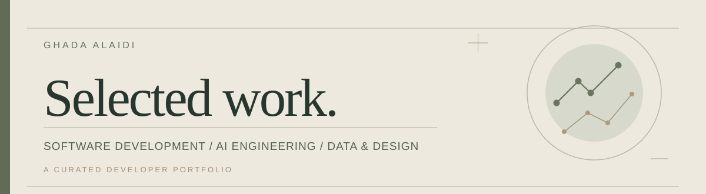

 

*Building purposeful digital experiences through software, AI, and design.*

[Selected Work](#01--selected-work) · [SDAIA Labs](#02--sdaia-labs) · [Tuwaiq Labs](#03--tuwaiq-labs) · [Experiments](#04--tests--experiments)

---

### 01 / Selected Work

A selection of projects bringing together product thinking, software engineering, and thoughtful user experiences.

<table>
  <tr>
    <td width="33%" valign="top">
      LEARNING &amp; GROWTH
      <h3>GROW / نمو</h3>
      
A botanical-inspired platform for self-discovery, learning preferences, and personal growth.

      
Product design · Assessments · Bilingual UX

      
<em>Private source · Portfolio showcase in preparation</em>

    </td>
    <td width="33%" valign="top">
      GRADUATION PROJECT
      <h3><a href="https://github.com/Ghada1425/SADA-Application">SADA / سَدى</a></h3>
      
A smart-park experience exploring visitor services, augmented reality, and AI-assisted discovery.

      
Systems design · UI/UX · AR

      
<strong>1st Place</strong> · Jouf University Scientific Forum, Applications Track

    </td>
    <td width="33%" valign="top">
      AGENTIC AI
      <h3><a href="https://github.com/Ghada1425/releasepulse-ai-agent">ReleasePulse</a></h3>
      
An LLM-powered QA agent that analyzes test reports and supports explainable release decisions.

      
Python · MCP · OpenRouter · Streamlit

      
SDAIA Academy capstone

    </td>
  </tr>
</table>

### 02 / SDAIA Labs

Hands-on work in AI engineering, data analysis, and experimentation.

- [A/B Testing Lab](https://github.com/Ghada1425/SDAIA_A-B-_testing) — Experiment design and evaluation practice.
- [Browse my repositories](https://github.com/Ghada1425?tab=repositories) — Additional coursework and technical notebooks.

### 03 / Tuwaiq Labs

Programming practice and Python fundamentals, kept in their original repositories.

- [Conditionals](https://github.com/Ghada1425/LAB_CONDITIONALS) · [Loops](https://github.com/Ghada1425/LAB_LOOPS) · [Functions](https://github.com/Ghada1425/LAB_FUNCTIONS_101)
- [Dictionaries](https://github.com/Ghada1425/LAB_DICTIONARY) · [Lists & Tuples](https://github.com/Ghada1425/LAB_LIST_TUPLES) · [Strings](https://github.com/Ghada1425/LAB_ARITHMETIC_STRINGS_OPERATIONS)

Course affiliation for individual forked labs can be refined after verification; their original repositories are unchanged.

### 04 / Tests & Experiments

Smaller explorations, coding practice, and CI experiments.

- [ci-practice](https://github.com/Ghada1425/ci-practice) — Continuous integration practice.
- [My-REPO](https://github.com/Ghada1425/My-REPO) — General experiments and practice.

---

### Toolkit & Interests

| Area | Focus |
| :--- | :--- |
| **Development** | Python · Java · JavaScript · React · HTML/CSS |
| **AI & Data** | LLM applications · Agentic systems · MCP · Pandas · Excel · Power BI |
| **Design & Delivery** | UI/UX · Figma · Prototyping · Git & GitHub |

**Languages** &nbsp; Arabic · English

---

  Curated with care · Ghada Alaidi

